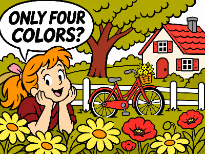
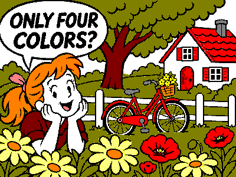

# OEPL-Toolbox

Browser-based image editor for OpenEPaperLink. Originating from [img2vlw](https://github.com/olanwe/img2vlw), expanded into this toolbox with AI assistance. Runs locally without installation, an account or external fonts.

Independent project; not an official OpenEPaperLink application and not affiliated with the OpenEPaperLink project.

[Deutsche Dokumentation](README.md)

## Rendering example: four display colors, more tones

| AI-generated source | BWRY · fixed mixtures, up to 2 colors per tone |
|---|---|
|  |  |

Both images are 400 × 300 pixels. The output contains only white, black, red and yellow pixels: black/yellow appears olive, red/yellow orange and white/red pink. It was rendered with the unmodified Toolbox converter. Perceived colors depend on the panel and viewing distance. [Source and settings](docs/examples/README.md).

## Getting started

Download [oepl-toolbox.html](oepl-toolbox.html) using GitHub’s “Download raw file” button and open it locally. The single file contains all required components. Image editing and LED simulation work offline; only AP connections need network access.

From a source checkout, open `img2vlw.html` with `style.css`, `js/` and `vendor/` alongside it. `legacy.html` preserves the original application. The ioBroker calendar is a separate project and is not included here.

## Image preparation

- Load files or paste images from the clipboard, with source and output shown side by side.
- Choose BW, BWR, BWY, BWRY, Spectra 3100 Plus, Spectra 6, ACeP7 or named custom palettes. RGB targets are not physical measurements of panel pigments.
- Use size presets, fit/fill/stretch, 1:1 placement or free scaling; position the image within the output.
- Draw, move and resize crops, optionally constrained to the display aspect ratio, or enter source-pixel coordinates.
- Rotate the source independently from display orientation. Sending restores the native display format.
- Adjust brightness, contrast, saturation, threshold and per-color preferences; double-click sliders to restore defaults.
- Apply independent dark-line, color-line, text and surface optimization strengths, with comic/diagram/text presets.

## Color output

| Method | Use |
|---|---|
| No dithering | Map each pixel to a display color |
| Floyd–Steinberg | Approximate tones and gradients through error diffusion |
| Bayer 4×4 | Ordered, repeatable pixel patterns |
| Fixed mixtures | Discrete tones made from equal mixtures of up to 1–4 display colors per tone |
| Continuous tones | Keep corrected or palette-gamut-limited tones for later AP conversion |

The 1–4 limit applies to participating display colors **per mixture**, not the total number of tones. For BWRY, a black/yellow pattern can appear olive while the output still contains only actual palette colors. Physical pigment behavior is not calibrated or simulated.

Source and output have independent view zoom, mouse/touch navigation and an expandable workspace. Distance preview smooths the native-sized output before display scaling; it never changes exported pixels.

## Drawing and test charts

A separate drawing layer supports lines, rectangles, circles/ellipses, editable text with font selection, erasing and inserted images. Select, move and resize objects, change text/colors, undo/redo and save layer plans. Drawing edits reuse the converted source instead of running the full conversion again.

Test charts include borders/corners, color patches, 1/2/4-pixel lines, two-/multi-color mixtures and gradients, plus full-color fills, checkerboards and color noise. Labels adapt to small displays.

## Export

- **PNG:** lossless palette pixels with optional transparency.
- **OEPL JPEG:** baseline, 4:4:4, quality 100; alpha is flattened to white. JPEG remains lossy and does not guarantee exact palette pixels.
- **VLW / VLW.GZ:** multiple color planes including white and transparency, cropped to occupied areas. Gzip is enabled by default and imports can decompress automatically. Suitable AP/renderer support is required.
- **Layer plans:** retain drawing objects for later editing.

Save in native display format or the current orientation, optionally exporting content only instead of fit margins. Sending and VLW tests always use native orientation. The VLW-specific size warning describes renderer limits, not a general PNG/JPEG restriction.

Output limits: four million pixels, at most 4096 per axis. Source limit: 24 million pixels. Animated images are treated as one browser-rendered frame.

## AP integration

Enter an AP address or check saved addresses and `openepaperlink.local`. Browsers cannot perform general network discovery. Select tags, apply their profiles and read available AP image data.

Send images directly, store/import JPEG and VLW files on the AP, and create/test positioned VLW templates. If JPEG upload receives HTTP 413, the app uses AP file storage before activating the uploaded file; free space is required.

No upload runs automatically. Browser CORS, mixed-content and local-network restrictions may block connections; serving the app from the same AP can help. Additional AP rotation/inversion is not silently changed. AP image data can differ from the last image actually shown by the tag.

## LED designer

Design colors, intervals, repetitions and loops with nRF/ESP32/EFR32 profiles and all six RGB channel orders. Timeline, simulation, PWM slow motion, representable steps/times/counts, on-times and a calibratable energy estimate are provided. Save JSON/design presets or test a sequence on a selected display.

The simulation follows the selected wire model and displays rounded output colors; it does not replace testing actual hardware. See [LED-DESIGNER.md](LED-DESIGNER.md) for behavior and firmware references.

## Language, appearance and development

German/English initially follow browser preferences; manual selection takes precedence. Appearance can be automatic, light or dark. Settings and custom presets remain local.

Use Node.js 22 or later. No additional npm packages are required for tests/build.

```sh
npm test
npm run build
npm run build -- oepl-toolbox.html
npm run build:converter
```

The default build writes to `dist/`; the third command refreshes the checked-in standalone file. Keep it updated after source changes. Additional browser scenarios in `tests/*-browser-check.js` use local pages or mocked APs. The pure converter can be embedded independently: [API and examples](IMAGE-CONVERTER.md).

When filing issues, include browser/toolbox version, palette and reproduction steps; remove private images, AP addresses and MACs before publishing.

## License

GPL-3.0: [LICENSE](LICENSE). Bundled jpeg-js 0.4.4 encoder: BSD-3-Clause, [vendor/jpeg-js.LICENSE](vendor/jpeg-js.LICENSE). Both license texts are embedded in the standalone HTML.
