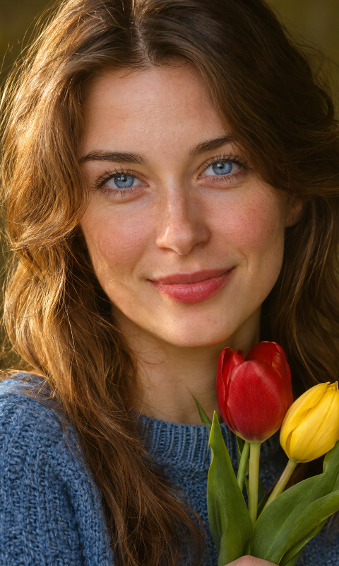
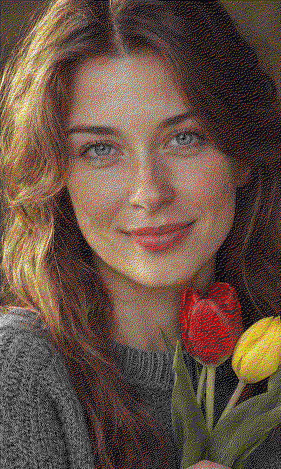
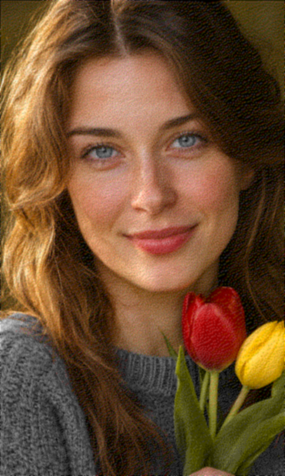
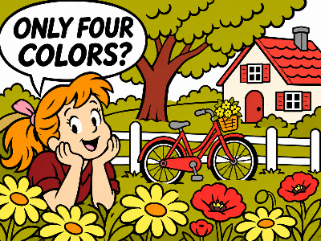
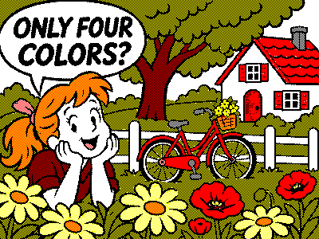

# OEPL-Toolbox

Lokaler Bildeditor für OpenEPaperLink. Entstanden aus [img2vlw](https://github.com/olanwe/img2vlw) und mit Unterstützung von KI zur heutigen Toolbox erweitert. Läuft vollständig im Browser, ohne Installation, Konto oder externe Schriftarten.

Unabhängiges Projekt; keine offizielle Anwendung des OpenEPaperLink-Projekts und nicht mit diesem verbunden.

[English documentation](README.en.md)

## Renderbeispiel: vier Displayfarben, mehr Farbtöne

### Foto mit Floyd–Steinberg

| KI-generierte Vorlage | BWRY · Floyd–Steinberg | Entfernungsvorschau |
|---|---|---|
|  |  |  |

7,5-Zoll-Format im Hochformat: **480 × 800 Pixel** (nativ 800 × 480, um 90° gedreht). Die Vorlage wurde mittig auf das Seitenverhältnis zugeschnitten. Auch Augen und Pullover können noch kühl oder bläulich wirken, obwohl die Displaydatei ausschließlich Weiß, Schwarz, Rot und Gelb enthält.

Die Entfernungsvorschau glättet die fertige Ausgabe mit **1,2 Pixel Gauß-Unschärfe in nativer Auflösung, vor jeder Anzeigeskalierung**. Nur diese Vorschaugrafik enthält zusätzliche RGB-Zwischentöne; die Displaydatei bleibt unverändert. Sie veranschaulicht die optische Mittelung und entspricht keinem kalibrierten Betrachtungsabstand. [PNG für das Display](docs/examples/portrait-bwry.png) · [Einstellungen und Herkunft](docs/examples/README.md).

### Comic mit festen Mischfarben

| KI-generierte Vorlage | BWRY · feste Mischfarben, bis zu 2 Farben pro Mischton |
|---|---|
|  |  |

Beide Bilder sind 400 × 300 Pixel groß. Die Ausgabe enthält ausschließlich weiße, schwarze, rote und gelbe Pixel: Schwarz/Gelb wirkt oliv, Rot/Gelb orange und Weiß/Rot rosa. Das Ergebnis stammt aus dem unveränderten Toolbox-Konverter. Die Farbwahrnehmung hängt vom Panel und Betrachtungsabstand ab. [Vorlage und Einstellungen](docs/examples/README.md).

## Schnellstart

[**Toolbox direkt im Browser öffnen**](https://htmlpreview.github.io/?https://github.com/olanwe/oepl-toolbox/blob/main/oepl-toolbox.html) – über den externen Dienst GitHub HTML Preview, ohne Download.

Für den Zugriff auf einen lokalen HTTP-AP empfiehlt sich die lokal gespeicherte Datei; die HTTPS-Vorschau kann dabei durch Browser-Sicherheitsregeln eingeschränkt sein.

Die fertige [oepl-toolbox.html](oepl-toolbox.html) mit GitHubs „Download raw file“ herunterladen und lokal im Browser öffnen. Die Einzeldatei enthält alle benötigten Bestandteile. Bildbearbeitung und LED-Simulation funktionieren offline; nur Verbindungen zu einem AP benötigen Netzwerkzugriff.

Aus dem Quellcode lässt sich alternativ `img2vlw.html` öffnen; `style.css`, `js/` und `vendor/` bleiben daneben. `legacy.html` enthält die ursprüngliche Anwendung.

## Bilder vorbereiten

- Bilder aus einer Datei oder der Zwischenablage übernehmen; Quelle und Displayvorschau nebeneinander betrachten.
- Paletten BW, BWR, BWY, BWRY, Spectra 3100 Plus, Spectra 6 und ACeP7 sowie eigene benannte Farbpresets. RGB-Zielwerte sind keine Messung der tatsächlichen Panelpigmente.
- Displaygrößen vorwählen oder frei eingeben. Einpassen, Füllen, Strecken, 1:1-Platzierung und freie Skalierung; das Bild im Ziel verschieben.
- Ausschnitte aufziehen, verschieben und an Rändern/Griffen verändern, bei Bedarf an das Displayseitenverhältnis binden. Werte lassen sich auch numerisch einstellen.
- Quelle unabhängig vom Ausgabedisplay drehen. Die Zielansicht berücksichtigt die Aufstellung; beim Versand wird in das ursprüngliche Displayformat zurückgedreht.
- Helligkeit, Kontrast, Sättigung, Hell-Dunkel-Schwelle und Farbgewichtungen einstellen. Doppelklick auf einen Regler setzt dessen Standardwert zurück.
- Dunkle/farbige Linien, Schrift und Flächen mit getrennten Optimierungsstärken behandeln. Presets für Comics, Diagramme und Text dienen als Ausgangspunkt.

## Farbausgabe

| Verfahren | Zweck |
|---|---|
| Ohne Dithering | Jeden Pixel einer verfügbaren Displayfarbe zuordnen |
| Floyd–Steinberg | Farbtöne und Verläufe durch Fehlerdiffusion annähern |
| Bayer 4×4 | Geordnete, wiederholbare Pixelmuster |
| Feste Mischfarben | Klare Farbstufen aus gleichmäßigen Mischungen von höchstens 1–4 Displayfarben pro Mischton |
| Kontinuierliche Farbstufen | Korrigierte bzw. auf den Palettenfarbraum begrenzte Farbstufen für eine spätere Konvertierung am AP |

Die Grenze von 1–4 betrifft die beteiligten Displayfarben **pro Mischton**, nicht die Zahl der Farbtöne im ganzen Bild. Bei BWRY kann beispielsweise ein Schwarz/Gelb-Muster wie Oliv wirken; die Datei enthält weiterhin ausschließlich die tatsächlichen Palettenfarben. Physische Pigmentmischungen werden nicht kalibriert simuliert.

Quell- und Zielansicht besitzen getrennten Anzeigezoom und Navigation per Maus/Touch. Die Arbeitsfläche lässt sich vergrößern; die Vorschau bleibt beim Bearbeiten möglichst sichtbar. Die Entfernungsvorschau glättet nur die Anzeige in nativer Auflösung vor dem Anzeigezoom. Exportierte Pixel bleiben unverändert.

## Zeichnen und Testbilder

Eine getrennte Zeichenebene unterstützt Linien, Rechtecke, Kreise/Ellipsen, Text mit Schriftwahl, Radieren und eingefügte Bilder. Elemente lassen sich auswählen, verschieben und skalieren; Text und Farben sind nachträglich bearbeitbar. Rückgängig/Wiederholen und Ebenenpläne stehen zur Verfügung. Änderungen an der Zeichenebene benötigen keine erneute Konvertierung des Quellbildes.

Testbilder können Begrenzungs-/Eckmarken, Farbflächen, 1/2/4-Pixel-Linien, Zwei-/Mehrfarbmischungen und Verläufe zeigen. Vollfarbe, Schachbrett und Farbrauschen sind zusätzliche Prüfvarianten. Beschriftungen passen sich an kleine Displays an.

## Export und VLW

- **PNG:** verlustfreie Palettenpixel mit optionaler Transparenz.
- **OEPL-JPEG:** Baseline, 4:4:4, Qualität 100; Transparenz wird weiß hinterlegt. JPEG bleibt verlustbehaftet und garantiert keine pixelgenaue Wiedergabe.
- **VLW / VLW.GZ:** mehrere Farbebenen einschließlich Weiß und Transparenz; Ebenen werden auf belegte Bereiche zugeschnitten. Gzip ist standardmäßig eingeschaltet und kann beim Import automatisch entpackt werden. Geeignete aktuelle AP-/Rendererunterstützung ist erforderlich.
- **Ebenenplan:** zum späteren Weiterbearbeiten der Zeichnung.

Speichern ist wahlweise im ursprünglichen Displayformat oder in der aktuellen Darstellung möglich; bei Bedarf nur mit dem belegten Bildinhalt statt der Einpassränder. Direktversand und VLW-Test verwenden das native Displayformat. Der Größenhinweis am VLW-Export betrifft Grenzen des jeweiligen VLW-Renderers; er ist keine allgemeine PNG-/JPEG-Beschränkung.

Zielbilder sind auf vier Millionen Pixel und 4096 Pixel je Achse begrenzt, Quellbilder auf 24 Millionen Pixel. Animierte Bilder werden als einzelner vom Browser gelieferter Frame behandelt.

## AP-Verbindung

AP-Adresse direkt eingeben oder gespeicherte Ziele und `openepaperlink.local` prüfen lassen. Ein allgemeiner Netzwerkscan ist im Browser nicht möglich. Displays lassen sich auswählen, ihre Profile übernehmen und verfügbare Bilddaten einlesen.

Bilder können direkt an ein Display gesendet oder als JPEG/VLW im AP-Dateisystem abgelegt und von dort geladen werden. VLW-Templates mit X/Y-Position können erzeugt und getestet werden. Beim JPEG-Uploadfehler HTTP 413 verwendet die Anwendung die AP-Dateiablage und aktiviert anschließend die hochgeladene Datei. Dafür wird freier Speicher benötigt.

Kein Upload startet automatisch. Browser können Zugriffe auf lokale HTTP-APs durch CORS, Mixed Content oder Netzwerkberechtigungen blockieren. Bei Bedarf die Einzeldatei vom selben AP bereitstellen. Rotation/Invertierung im AP zusätzlich zur Toolbox beachten; die Anwendung ändert diese AP-Einstellungen nicht heimlich. Empfangene AP-Bilddaten müssen nicht dem zuletzt tatsächlich gezeigten Displaybild entsprechen.

## LED-Designer

Blinkgruppen mit Farben, Intervallen, Wiederholungen und Loops entwerfen. Der Designer bietet Firmwareprofile für nRF, ESP32 und EFR32, sechs RGB-Kanalreihenfolgen, Zeitstrahl, Simulation und PWM-Zeitlupe. Verfügbare Farbstufen, übertragbare Zeiten/Loops, Leuchtdauern und eine kalibrierbare Energieabschätzung werden berücksichtigt. Designs lassen sich als JSON bzw. Presets speichern und an ein ausgewähltes Display senden.

Die Simulation verwendet das jeweilige Übertragungsmodell und zeigt gerundete Ausgabefarben. Sie ersetzt keine Prüfung des konkreten Tags. Details und Firmwarequellen: [LED-DESIGNER.md](LED-DESIGNER.md).

## Sprache und Darstellung

Deutsch oder Englisch wird zunächst aus den Browserpräferenzen gewählt; eine manuelle Auswahl hat Vorrang. Heller/dunkler Modus lässt sich automatisch oder manuell einstellen. Einstellungen und eigene Presets bleiben lokal im Browser; es gibt keine Cloudpflicht.

## Entwicklung

Node.js 22 oder neuer; keine zusätzlichen npm-Pakete für Tests und Build.

```sh
npm test
npm run build
npm run build -- oepl-toolbox.html
npm run build:converter
```

Der Standardbuild schreibt nach `dist/`. Der dritte Aufruf aktualisiert die mitgelieferte Einzeldatei; sie nach Quelländerungen mit aktualisieren. Rechenmodelle werden mit Node getestet, zusätzliche Browserprüfungen liegen unter `tests/*-browser-check.js` und verwenden lokale Seiten bzw. simulierte APs.

Der reine Bildkonverter lässt sich unabhängig einbetten: [Schnittstelle, Optionen und Beispiele](IMAGE-CONVERTER.md). Für Fehlermeldungen Browser-/Toolbox-Version, Palette und reproduzierbare Schritte angeben; private Bilder, AP-Adressen und MACs vor dem Veröffentlichen entfernen.

## Lizenz

GPL-3.0, siehe [LICENSE](LICENSE). Der eingebundene JPEG-Encoder jpeg-js 0.4.4 steht unter BSD-3-Clause, siehe [vendor/jpeg-js.LICENSE](vendor/jpeg-js.LICENSE). Beide Lizenztexte sind auch in der fertigen Einzeldatei enthalten.
